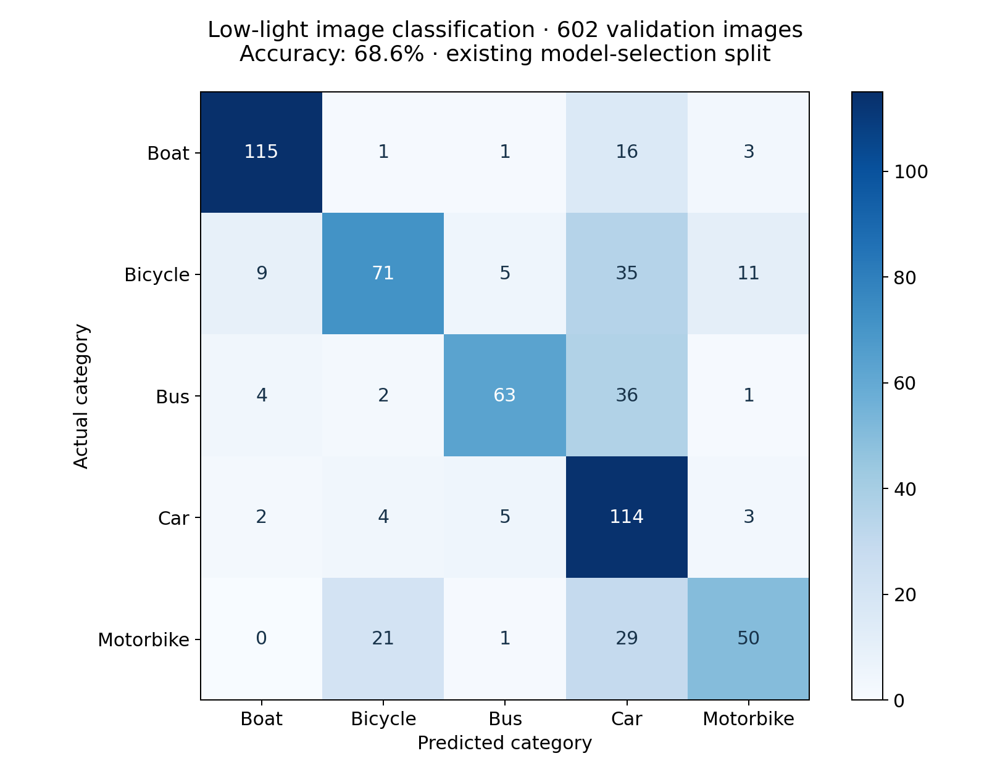
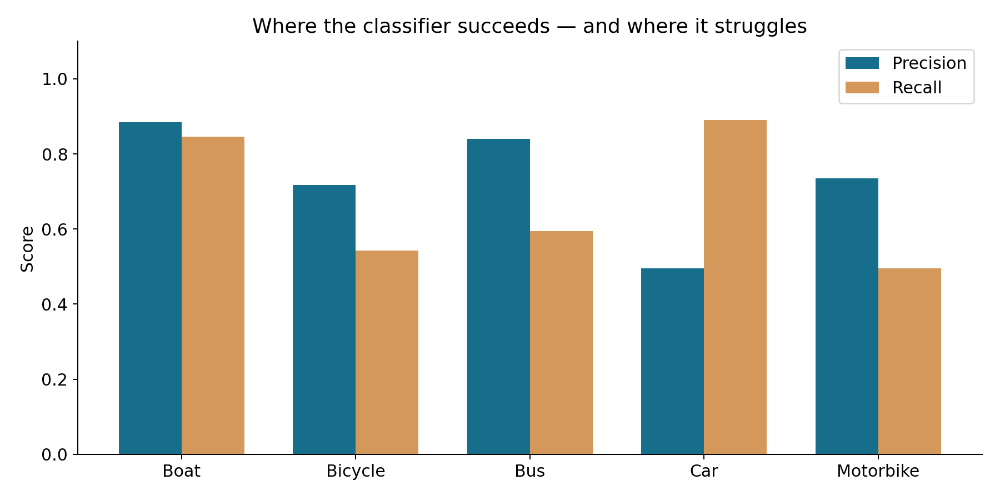

# Low-light Vision

A 2024 academic computer-vision experiment classifying boats, bicycles, buses, cars and motorbikes in low-light images. The pipeline combines CLAHE contrast adjustment, denoising, sharpening and MobileNetV2 transfer learning.

## Results

The saved checkpoint was evaluated again on 12 October 2026 against all **602 images in the existing validation split**, yielding **68.6% accuracy**. This split was used during training/model selection: it is not an independent test set, nor a production benchmark. The model overpredicts cars; bicycle and motorbike recall need improvement. See the confusion matrix and per-class precision/recall in `results/`.





## Run

Use Python 3.12 and an isolated environment:

```powershell
python -m venv .venv
.venv/Scripts/python -m pip install -r requirements.txt
.venv/Scripts/python evaluate.py --model /path/to/best_model.keras --data /path/to/preprocessed/test --output results
```

The validation directory must contain `Boat`, `Bicycle`, `Bus`, `Car` and `Motorbike` subfolders. Evaluation matches the checkpoint's training inputs: prepared RGB images resized to 224×224 and scaled to [0,1]. Do not apply preprocessing twice. `experiment.ipynb` contains the preprocessing and training workflow. Its saved outputs are removed; enabling the parent MobileNetV2 model before selectively unfreezing layers repairs the fine-tuning configuration. The reported results use the original saved checkpoint, not a newly retrained model.

Dataset photographs and model weights are excluded from this public repository. Supply your own authorized copies to run inference or training. No cloud service or image upload is involved.

## Dataset credit

This academic experiment uses a five-class subset of [Exclusively Dark (ExDark)](https://github.com/cs-chan/Exclusively-Dark-Image-Dataset), by Yuen Peng Loh and Chee Seng Chan, *Getting to Know Low-light Images with the Exclusively Dark Dataset*, Computer Vision and Image Understanding, 178 (2019), 30–42. Obtain the dataset from its authors and follow their current terms and third-party image rights. This repository does not redistribute it.

Authored by Doddie Prawarjito. TensorFlow, Keras, OpenCV and pretrained MobileNetV2 retain their respective ownership and licences.
